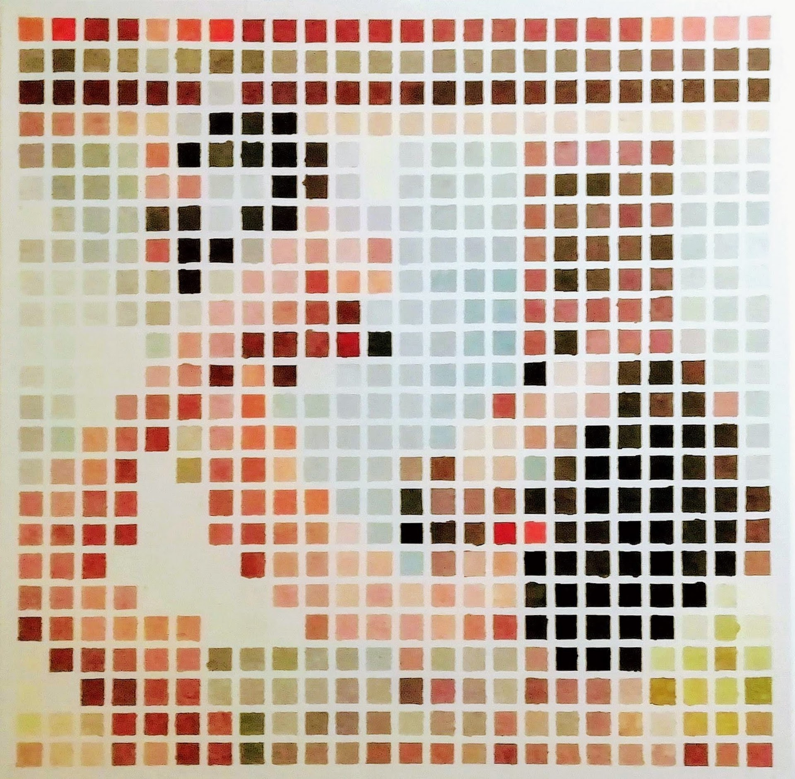

Hola,

Mi nombre es Jaime. Nací en León (España), pero crecí en Madrid. _Oficialmente_ he vivido en los
Países Bajos y en Alemania. También he intentado viajar (casi) todo lo que he podido. Pero aún así,
diría que sólo capaz de expresarme con total libertad en un único idioma: este en el que escribo.
Posiblemente también publique algo en inglés, y si me animo, en alemán o en neerlandés.

Supongo que algún día actualizaré esta sección. O no.

¡Salud!

<figure className="post-image-figure">

<figcaption>"Knappe man met bota" por Emelie Hofland.</figcaption>

</figure>
