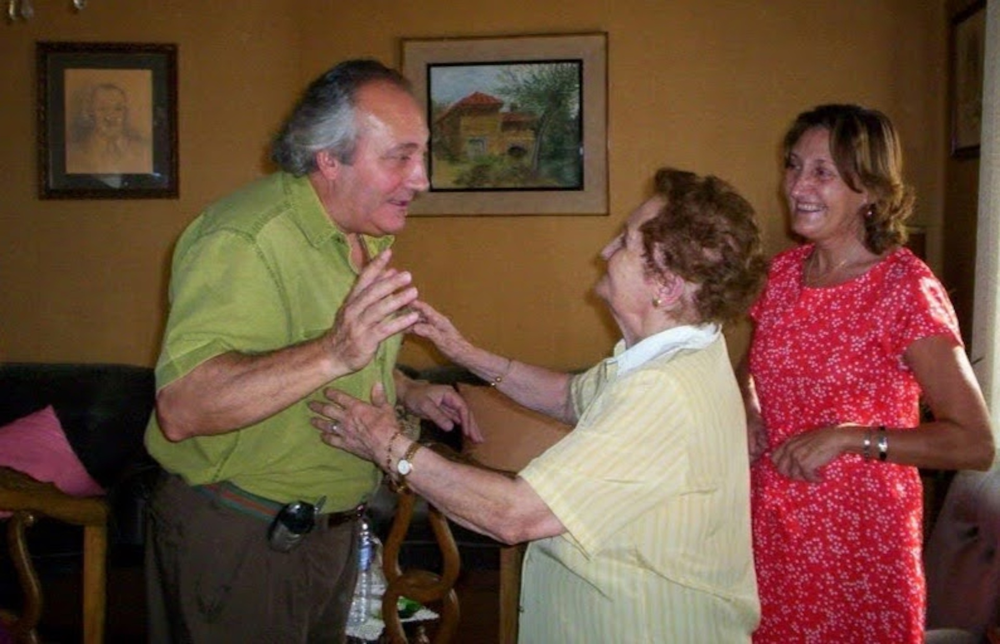

Algunos mueren, otros son recordados. Mi tío, Anastasio Berciano Fuertes (o simplemente Tasio) es
de los segundos.

En su famoso poema _Song of Myself_ (_Canto a mí mismo_), Walt Whitman escribió ese críptico y
archiconocido verso: [_"I contain multitudes"_](https://poets.org/poem/song-myself-51), es decir
**_"contengo multitudes"_**. Tiene muchas interpretaciones, pero una de las que más me gusta
consistiría en vernos a nosotros mismos como un microcosmos, en el cual todas las personas que
recordamos siguen vivas a través de nuestros recuerdos. Interactúan entre sí, no envejecen y están
congeladas en el tiempo. No han muerto, las recordamos. Son parte de esas multitudes que cada uno
de nosotros contenemos. Somos así porque no se han ido, y nos siguen definiendo cada día.

Para Whitman, la palabra _multitudes_ tenía más que ver con la variedad que con la cantidad. Mi
lista es más bien breve, pero a algunas de esas personas las tengo presentes casi a diario; digamos
que se encuentran en la lista selecta. Mi tío está ahora incluido en mis multitudes, y jamás será
olvidado. Estos días he estado pensando mucho en cómo hubiera sido su mensaje para felicitarme una
alegría que me ha dado la vida recientemente. Mi imaginación intenta construir una aproximación,
intenta emular su maestría con las palabras y su cariñosa, humorística y genial idiosincrasia. Pero
no he sido capaz, porque sé que nunca será lo mismo. Él era único: simplemente Tasio.

La vida no siempre le sonrió. Pero en lugar de caer en la amargura que a veces parece inevitable,
siguió su labor de conectar, armonizar, informar, alegrar y ante todo enriquecer la vida de
cualquiera que se cruzase en su camino. Sencillamente era imposible no reflexionar sobre las
palabras que habían sido intercambiadas. Se continuaba con el día, pero ya _de otra forma_, con
otra luz. Hoy en día, una cordialidad en peligro de extinción. Difícil de explicar, es una energía
que pocas personas pueden transmitir. Y por circunstancias de la vida, algunos le conocimos
relativamente tarde, pero solo alguien como él fue capaz de recuperar el tiempo perdido.

<figure className="post-image-figure">

<figcaption>Algunas de mis multitudes.</figcaption>

</figure>

Me encanta esta foto: mi tío Tasio, mi abuela Tita, mi madre Carmen María, y en la esquina un
retrato de mi abuelo Tito. Una suerte de instante capturado que puede parecer mundano, pero se
vuelve mágico y preciado cuando te percatas de que muchas de las personas que quieres y admiras ya
no están. Aquí Tasio comenta algo, seguramente una anécdota curiosa, con su característica ligera
sonrisa. Ironía, rara vez. Cinismo, nunca. Creatividad desbordante, siempre. Provocaba una reacción
instantánea en cualquiera que estuviese alrededor, haciendo prácticamente imposible ignorar la
conversación. 

Tres de las personas representadas en esta foto (si incluimos el mencionado retrato) nos han
dejado, pero rememoro con frecuencia sus dichos, sus gestos, su presencia. Como he dicho, ahora son
parte de mis multitudes particulares. Al final, quizá lo que cuenta no es vivir por vivir, quemar
los días y arrastrar los años como un ancla. Tampoco cómo vivimos exactamente, si no cómo seremos
recordados y si seremos dignos de ese modesto fragmento de inmortalidad. La pregunta entonces sería
**en qué multitudes seremos incluidos**. Tasio fue una persona extraordinaria, desde ahora
_contenida_ en todos aquellos que tuvimos la suerte de cruzarnos con él. Recordarle nunca será un
esfuerzo, más bien al contrario: **no recordarle es una imposibilidad.**
