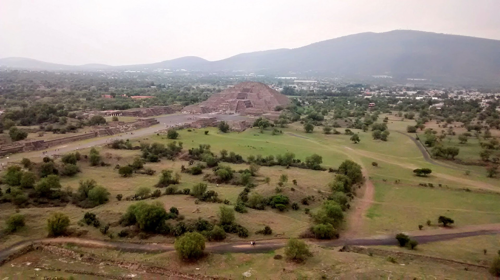

_**Mayo de 2017**, mera transcripción._

---

Escribo esto desde el punto más alto de la Pirámide del Sol, en [**Teotihuacán**](https://es.wikipedia.org/wiki/Teotihuacán). La brisa es perfecta, refresca pero sin enfriar. Están cayendo unas gotas de agua y a lo lejos se prepara una tormenta. Si no fuera por los putos turistas, **la vista es jodidamente ceremonial** _(sic)_. Me siento como un conquistador en el siglo XVI... recién llegado.

_Vista desde la Pirámide del Sol en Teotihuacán, desde donde se puede ver la Calzada de los Muertos prolongándose hasta la Pirámide de la Luna._