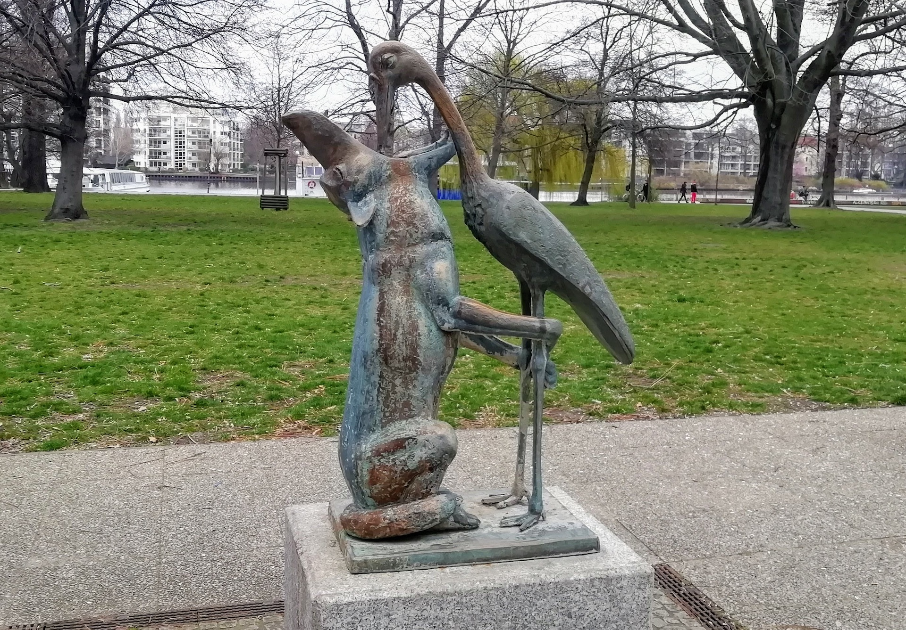
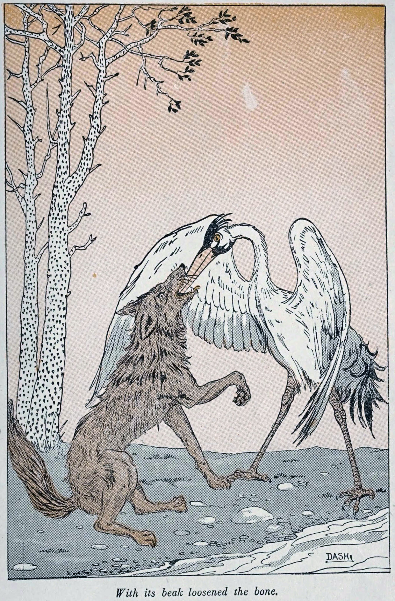

Uno de mis sitios favoritos para correr en Berlín es [Treptower Park](https://www.visitberlin.de/en/treptow-park). Me da sensación de amplitud, no está tan saturado de gente como otros parques, puedo improvisar nuevas rutas y casi siempre descubro algo nuevo.

Hace bastante tiempo vi una escultura que me llamó la atención, pero no le di más vueltas. La segunda o tercera vez pensé por fin que podía representar un dicho, un refrán, o un cuento popular. El español es muy rico en expresiones y refranes, y el alemán no lo es menos. Indagando un poco descubrí que se trata de una obra del escultor serbo-alemán [Stephan Horota](https://de.wikipedia.org/wiki/Stephan_Horota) titulada _"Wolf und Storch"_ (el lobo y la grulla).

<figure className="post-image-figure">

<figcaption>"Wolf und Storch" de Stephan Horota, 1968–1970.</figcaption>

</figure>

Y a su vez, "el lobo y la grulla" es una fábula de [Esopo](https://es.wikipedia.org/wiki/Esopo). No es una de las más conocidas, al menos en castellano. Al parecer hay multitud de versiones en distintas culturas, con diferentes animales incluso. La mejor versión que he encontrado parece ser una traducción de [Ana María Matute](https://es.wikipedia.org/wiki/Ana_Mar%C3%ADa_Matute), basada a su vez en una adaptación del cuento original. Es más, aquí no hay grulla sino garza. Y dice así:

> Un lobo de pelo hirsuto y afilados colmillos habíase cebado con los bienes de gentes honradas y, al fin recibió amenazas de que iba, por ello, a ser colgado. Pidió ayuda a una garza muy hábil con la promesa de una fuerte suma.
> 
> La garza defendió muy bien la causa del lobo, y le salvó la cabeza. Luego pidió a su cliente el cumplimiento de la palabra dada.
> 
> -¡Cómo! -exclamó el malvado-. ¿Acaso no he permitido que te vayas, sin degollarte? ¡Considérate afortunada de que no haya triturado tu mísera osamenta, ni arrancado la peluca, ni desgarrado la ropa, hasta el último de sus _frufrús_! **No esperes otra recompensa por haber salvado a un lobo.**

Aunque elegante e intensa, esta versión no hace referencia alguna a la (supuesta) premisa del cuento original, en el cual el lobo se había tragado una espina o un hueso, y se le había atragantado. Entonces el lobo fue a buscar ayuda, ofreciendo a la grulla una recompensa. Y de ahí el simbolismo de la estatua, en la que la grulla introduce su largo pico en las fauces del lobo para retirar el molesto hueso. Cuando el lobo se disponía a marcharse, la grulla le hizo detenerse, exigiendo su merecida recompensa.

**_-¿No es suficiente que te haya dejado sacar la cabeza de mis fauces sin habértela arrancado?_**

La moraleja podría ser bien concisa: _no me seas grulla_. Esopo lo sabía, y si estás leyendo esto significa que unos 2.600 años después aún no está tan claro como parece. Se empieza haciendo la grulla, y se continúa dando la otra mejilla.

Desde niños, nos imbuyen la idea de ayudar al prójimo incondicionalmente. Incluso sabiendo de antemano que _el prójimo puede ser un hijo de la grandísima puta_. Cuando era más joven, no dudaba en invertir mi tiempo y recursos de forma casi descerebrada en cualquiera que necesitase una mano. Cuanto más viejo me hago, más selectivo me he vuelto. Y aún no todo lo que hubiera deseado.

Normalmente me muevo por el principio de ignorancia, es decir, asumo que carezco de suficiente información. Una especie de _presunción de buena fe_. Una de mis máximas es intentar dar el mismo trato a todo el mundo, al menos desde el punto de partida, por así decirlo. Cuando era más joven, los prejuicios tenían un mayor impacto en mis acciones. Con los años, el recorrido, y las charlas de bar he aprendido que los prejuicios son, casi siempre, infundados.

Sin embargo, si tengo la más mínima prueba de que el prójimo no merece ni merecería mi ayuda, independientemente de su condición particular, no sólo no le presto ayuda, sino que me regocijo en su desgracia. No es _muy cristiano_ por mi parte. Tampoco me quita el sueño. A lo largo de mi vida, religiosos y pusilánimes varios han intentado convencerme de que esta forma de pensar y actuar es tóxica. Y me reitero: toxicidad es ayudar a quien no se lo merece.

Huelga decir que esta máxima me ha causado molestias tanto a nivel personal como profesional. Y es que en el fondo, 2.600 años después, la moral occidental sigue sin estar preparada para las enseñanzas de Esopo.

**No esperes recompensa, y deja que se atragante el muy hijo de puta.**

<figure className="post-image-figure">

<figcaption>Ilustración de Joseph E. Dash, del libro "Aesop's Fables" (Albert Whitman & Company), publicado en 1925.</figcaption>

</figure>
